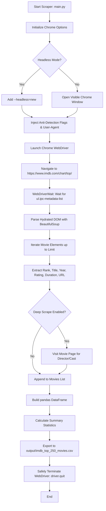

# 🎬 IMDb Top 250 Movie Rating Scraper

An automated, reliable, and beginner-friendly web scraping tool built with **Python**, **Selenium**, and **pandas** that dynamically extracts, analyzes, and exports movie data from IMDb's official Top 250 chart into a structured CSV dataset.

[](https://www.python.org/)
[](https://www.selenium.dev/)
[](https://pandas.pydata.org/)
[](LICENSE)

---

## 📌 Table of Contents
- [Project Overview](#-project-overview)
- [Key Features](#-key-features)
- [Custom Interactive Web Observatory](#-custom-interactive-web-observatory)
- [System Architecture & Workflow](#-system-architecture--workflow)
- [How Technologies Work Together](#-how-technologies-work-together)
- [Directory Structure](#-directory-structure)
- [Installation Guide (Windows & VS Code)](#-installation-guide-windows--vs-code)
- [Usage & Execution](#-usage--execution)
- [CSV Output & Sample Rows](#-csv-output--sample-rows)
- [Statistical Insights](#-statistical-insights)
- [College Project / Mini-Project Documentation](#-college-project--mini-project-documentation)
- [Troubleshooting & FAQs](#-troubleshooting--faqs)
- [Ethical Scraping & Compliance](#-ethical-scraping--compliance)

---

## 📖 Project Overview

IMDb (Internet Movie Database) provides a regularly updated list of the Top 250 highest-rated movies of all time based on millions of user reviews. Because modern IMDb is rendered dynamically using client-side JavaScript frameworks (React / Next.js), traditional static scrapers (such as raw `requests` without a headless browser) fail or encounter HTTP 403 Forbidden blocks.

This project implements an automated, robust web scraper using **Selenium WebDriver** to render the DOM, **Explicit Waits** to synchronize with dynamic element hydration, and **pandas** to process, summarize, and export structured data into `imdb_top_250_movies.csv`.

---

## ✨ Key Features

1. **Dynamic Web Scraping with Selenium**
   - Renders modern client-side JavaScript without relying on static delays.
   - Employs **Explicit Waits** (`WebDriverWait` and `expected_conditions`) to ensure elements are hydrated before querying.
2. **Resilient Data Extraction**
   - Extracts: **Rank**, **Title**, **Release Year**, **IMDb Rating**, **Duration**, **Content Rating / Certificate**, **Vote Count**, and **Direct URL**.
   - Resilient against IMDb layout updates using multi-selector CSS fallbacks.
3. **Headless & Visible Browser Modes**
   - Run in the background (`--headless`) for maximum speed and server environments.
   - Run in visible GUI mode (`--no-headless`) to observe automated browser actions in real time.
4. **Structured CSV Export via pandas**
   - Automatically saves clean data to `output/imdb_top_250_movies.csv` with UTF-8 encoding (`utf-8-sig` for perfect Excel compatibility).
5. **Statistical Summary Generation**
   - Automatically computes dataset statistics upon completion: average rating, highest-rated movie, lowest-rated in Top 250, release year span, and content rating distributions.
6. **Configurable Execution & Deep Scraping**
   - Control scrape limit (e.g., top 10, top 50, or all 250).
   - Optional `--deep` mode to navigate individual movie pages for Directors, Cast, and Genres.
7. **Comprehensive Error Handling & Safe Cleanup**
   - Uses `try...finally` resource cleanup so Chrome and ChromeDriver processes never hang in memory.
   - Anti-bot stealth headers and automation masking (`navigator.webdriver` CDP overrides).
8. **Custom GetMovies Web Observatory**
   - A dedicated interactive website that visualizes the entire scraped dataset without copying IMDb's theme.
   - Cosmic obsidian aesthetic with ambient bioluminescent glows, frosted glass cards, and modern typography (`Plus Jakarta Sans` & `Outfit`).
   - Interactive Decade Bar Chart, Rating Histogram, Certification Donut Chart, and Watchlist system.

---

## 🌌 Custom Interactive Web Observatory

Included in the [`website/`](file:///C:/Users/pandi/.gemini/antigravity-ide/scratch/IMDb-Movie-Rating-Scraper/website) directory is a custom, standalone web application built from scratch to visualize the scraped Top 250 movies:

### 🌟 Observatory Highlights
- **Unique Theme**: Deep midnight obsidian space (`#080B12`), translucent glass cards (`backdrop-filter: blur(16px)`), radiant neon aurora glows, and holographic badges (no generic IMDb yellow boxes).
- **Interactive Analytics Deck**:
  - **Decade Timeline Chart**: Click any decade bar to filter movies from that era immediately.
  - **Rating Density Spectrum**: Visual distribution histogram of scores from 8.0 to 9.3.
  - **Certification Donut Ring**: Live share of R, PG-13, PG, and Approved films.
- **Dynamic Control Deck**:
  - Live instant search (press `/` to focus).
  - Era chips: *All Eras*, *Golden Classics (<=1960)*, *Vintage (1961-1989)*, *Modern (1990-2009)*, *Recent (2010+)*.
  - Rating threshold range slider with real-time score filtering.
  - Grid View vs. Compact Table View toggle.
  - Watchlist system (starred movies saved to browser `localStorage`).
  - **"Surprise Me"** random movie picker with modal animation.
  - **CSV Sync & Re-Export**: Load any updated scrape CSV or export your filtered view on the fly.

### 🌐 How to Launch the Web Observatory
From the project folder, simply open [`website/index.html`](file:///C:/Users/pandi/.gemini/antigravity-ide/scratch/IMDb-Movie-Rating-Scraper/website/index.html) directly in any web browser, or run:
```powershell
# Open via Python's built-in web server:
python -m http.server 8080 --directory website
```
Then visit **`http://localhost:8080`** in your browser.

---

## 🏛 System Architecture & Workflow



---

## 🧩 How Technologies Work Together

| Component | Role in Project | Why It Is Used |
| :--- | :--- | :--- |
| **Selenium WebDriver** | Browser Automation | Interacts with Google Chrome, executes JavaScript, and simulates real user navigation. |
| **Chrome WebDriver & webdriver-manager** | Driver Bridge | Mediates communication between Python Selenium commands and Chrome's binary. Automatically resolves matching driver versions. |
| **Explicit Waits (`WebDriverWait`)** | Synchronization | Prevents race conditions by pausing execution until dynamic DOM containers (`ul.ipc-metadata-list`) are fully present. |
| **BeautifulSoup 4** | HTML Parsing | Rapidly searches and traverses parsed DOM nodes using CSS selectors in memory. |
| **pandas** | Data Processing | Structures extracted dictionaries into a 2D tabular DataFrame, computes aggregations/statistics, and formats CSV export. |
| **CSV Export (`to_csv`)** | Persistent Storage | Saves data with standard comma delimiters and UTF-8 encoding for consumption in Excel, Tableau, PowerBI, or SQL. |

---

## 📂 Directory Structure

```text
IMDb-Movie-Rating-Scraper/
│
├── main.py                  # Primary scraper script with CLI arguments and statistical summary
├── requirements.txt         # Project dependencies (selenium, webdriver-manager, pandas, bs4)
├── README.md                # Comprehensive project documentation and college report
├── .gitignore               # Ignores virtual environments, pycache, and logs
│
└── output/
    └── imdb_top_250_movies.csv   # Scraped dataset (250 movies with complete metadata)
```

---

## 💻 Installation Guide (Windows & VS Code)

### Prerequisites
1. **Google Chrome**: Ensure Google Chrome is installed on your Windows PC.
2. **Python 3.10+**: Ensure Python is installed and added to your system `PATH`.

### Step 1: Clone or Open the Project
Open **VS Code**, then click **File > Open Folder...** and select:
```text
C:\Users\<YourUsername>\.gemini\antigravity-ide\scratch\IMDb-Movie-Rating-Scraper
```

### Step 2: Open Terminal in VS Code
Open a new integrated terminal in VS Code:
```text
Ctrl + `  (or Terminal -> New Terminal)
```

### Step 3: (Recommended) Create a Virtual Environment
In the VS Code terminal (PowerShell or Command Prompt):
```powershell
python -m venv .venv
```
Activate the virtual environment:
```powershell
# PowerShell:
.\.venv\Scripts\Activate.ps1

# Command Prompt (cmd):
.\.venv\Scripts\activate.bat
```

### Step 4: Install Dependencies
Install all required packages:
```powershell
pip install -r requirements.txt
```

---

## 🚀 Usage & Execution

### 1. Default Run (Scrapes All 250 Movies in Headless Mode)
```powershell
python main.py
```
*Extracts all 250 movies in ~15 seconds without opening any visible window.*

### 2. Visible GUI Mode (Watch the Browser Live)
```powershell
python main.py --no-headless
```
*Opens Google Chrome so you can visually watch the automation process.*

### 3. Custom Limit (e.g., Top 10 or Top 50 Movies)
```powershell
python main.py --limit 10
```

### 4. Deep Scraping (Extract Director & Cast)
```powershell
python main.py --limit 5 --deep
```
*Navigates to individual movie pages for the top records with polite delays.*

### 5. Custom Output File
```powershell
python main.py --output output/my_custom_movies.csv
```

---

## 📊 CSV Output & Sample Rows

The generated CSV is saved to `output/imdb_top_250_movies.csv`.

### Data Schema
- **`Rank`**: Official IMDb ranking integer (1 to 250).
- **`Title`**: Full title of the movie.
- **`Release_Year`**: 4-digit release year (e.g., `1994`).
- **`IMDb_Rating`**: Average user rating out of 10.0 (e.g., `9.3`).
- **`Duration`**: Movie runtime (e.g., `2h 22m`).
- **`Content_Rating`**: Age/content certification (e.g., `R`, `PG-13`, `Approved`).
- **`Vote_Count`**: Approximate total user ratings (e.g., `3.3M`, `904K`).
- **`URL`**: Canonical IMDb URL for the movie.
- **`Scraped_At`**: Timestamp of data extraction.

### Sample Rows (First 5 Records)
| Rank | Title | Release_Year | IMDb_Rating | Duration | Content_Rating | Vote_Count | URL | Scraped_At |
| :---: | :--- | :---: | :---: | :---: | :---: | :---: | :--- | :---: |
| 1 | The Shawshank Redemption | 1994 | 9.3 | 2h 22m | R | 3.3M | https://www.imdb.com/title/tt0111161/ | 2026-10-11 09:39:35 |
| 2 | The Godfather | 1972 | 9.2 | 2h 55m | R | 2.3M | https://www.imdb.com/title/tt0068646/ | 2026-10-11 09:39:35 |
| 3 | The Dark Knight | 2008 | 9.1 | 2h 32m | PG-13 | 3.2M | https://www.imdb.com/title/tt0468569/ | 2026-10-11 09:39:35 |
| 4 | The Godfather Part II | 1974 | 9.0 | 3h 22m | R | 1.5M | https://www.imdb.com/title/tt0071562/ | 2026-10-11 09:39:35 |
| 5 | The Lord of the Rings: The Return of the King | 2003 | 9.0 | 3h 21m | PG-13 | 2.2M | https://www.imdb.com/title/tt0167260/ | 2026-10-11 09:39:35 |

---

## 📈 Statistical Insights

Upon scraping completion, the script automatically generates an analytics summary:

```text
=================================================================
                 IMDb TOP MOVIES SUMMARY STATISTICS          
=================================================================
Total Movies Scraped : 250
Average IMDb Rating  : 8.31 / 10.0
Highest Rating       : 9.3 ('The Shawshank Redemption')
Lowest Rating in List: 8.0 ('The Incredibles')
Oldest Movie         : 1921 ('The Kid')
Newest Movie         : 2026 ('The Odyssey')

--- Content Rating Distribution (Top 5) ---
  * R           : 103 movies
  * PG          : 38 movies
  * PG-13       : 35 movies
  * Not Rated   : 21 movies
  * Approved    : 19 movies
=================================================================
```

---

## 🎓 College Project / Mini-Project Documentation

### 1. Abstract
The rapid growth of web-based digital media has generated vast quantities of movie ratings and audience feedback. IMDb is recognized worldwide as the preeminent source of film data. This project develops an automated Python web scraping system that leverages Selenium and Google Chrome WebDriver to navigate IMDb's dynamic Top 250 chart, extract high-value metadata, clean and structure the data with pandas, and store the output in CSV format for exploratory data analysis (EDA).

### 2. Problem Statement
Many contemporary websites rely heavily on client-side rendering frameworks (such as React, Vue, or Angular) and deploy anti-automation filtering. Simple HTTP clients like `urllib` or standard `requests` receive static placeholder HTML or are blocked by HTTP 403 Forbidden responses. An effective solution requires a browser-driven automation engine capable of running JavaScript, rendering the complete DOM tree, and parsing structured elements reliably.

### 3. Objectives
1. Implement browser automation using Selenium to load and render the dynamic IMDb Top 250 page.
2. Utilize Selenium explicit waits to prevent race conditions during DOM hydration.
3. Extract movie ranking, title, release year, IMDb rating, duration, certification, vote count, and URL.
4. Structure the collected records into a pandas DataFrame and export them to a clean CSV file.
5. Provide configurable execution (headless mode vs. visible GUI, custom limits, and deep page visits).
6. Perform automatic statistical summarization of ratings and release periods.

### 4. Methodology
1. **Automation Layer**: Chrome WebDriver configured with headless execution, custom user-agent headers, and automation suppression flags.
2. **Synchronization Layer**: `WebDriverWait` with `expected_conditions.presence_of_element_located` ensures the main container is present before extraction commences.
3. **Parsing Layer**: BeautifulSoup extracts data nodes using flexible CSS selectors, handling missing values gracefully.
4. **Data Engineering Layer**: Extracted dictionary arrays are converted into a pandas DataFrame, cleaned, typed, and saved with UTF-8 encoding.
5. **Analytics Layer**: Descriptive statistics (mean rating, extremes, decade spans) are calculated directly from the DataFrame.

### 5. Learning Outcomes
- Understanding the difference between static HTML scraping and dynamic DOM rendering.
- Mastery of Selenium WebDriver, explicit waits, and browser lifecycle management.
- Experience overcoming anti-bot headers and cross-platform encoding constraints.
- Practical data wrangling with pandas and file serialization with CSV.

---

## 🛠 Troubleshooting & FAQs

### 1. Error: `403 Forbidden` from IMDb
- **Cause**: IMDb detects an automated headless browser request missing standard browser headers or user-agent information.
- **Solution**: The script already includes built-in anti-detection flags (`--disable-blink-features=AutomationControlled`, realistic User-Agent, and CDP script to unset `navigator.webdriver`). Ensure you run the provided `main.py`.

### 2. Error: `UnicodeEncodeError: 'charmap' codec can't encode character...` on Windows
- **Cause**: Windows Command Prompt / PowerShell defaults to code page `cp1252` instead of UTF-8 when printing emojis or special characters.
- **Solution**: `main.py` explicitly executes `sys.stdout.reconfigure(encoding="utf-8")` and uses standard ASCII characters for all output messages.

### 3. Error: `SessionNotCreatedException: This version of ChromeDriver only supports Chrome version X`
- **Cause**: An outdated ChromeDriver executable is cached on your system.
- **Solution**: `main.py` utilizes `webdriver-manager` to automatically download the exact matching driver version for your installed Google Chrome. You can also clear cache in `C:\Users\<username>\.wdm\`.

### 4. `TimeoutException` Waiting for Elements
- **Cause**: Slow internet connection or IMDb experiencing temporary downtime.
- **Solution**: Increase the timeout in `WebDriverWait(driver, 20)` in `main.py`, or test your network connection by visiting [IMDb Top 250](https://www.imdb.com/chart/top/) in a regular browser.

---

## ⚖ Ethical Scraping & Compliance

- **Polite Requests**: The scraper makes a single page request to retrieve all 250 movies on the chart.
- **Respectful Delays**: Deep scraping of individual movie pages enforces polite sleep intervals (`1.2s`) to avoid server strain.
- **Public Data**: Only publicly accessible rankings and ratings are collected. No login credentials or CAPTCHAs are bypassed.
- **Personal & Educational Use**: This tool is designed strictly for academic study, research, and educational demonstration.

---

**Developed with Python, Selenium, & pandas.**
